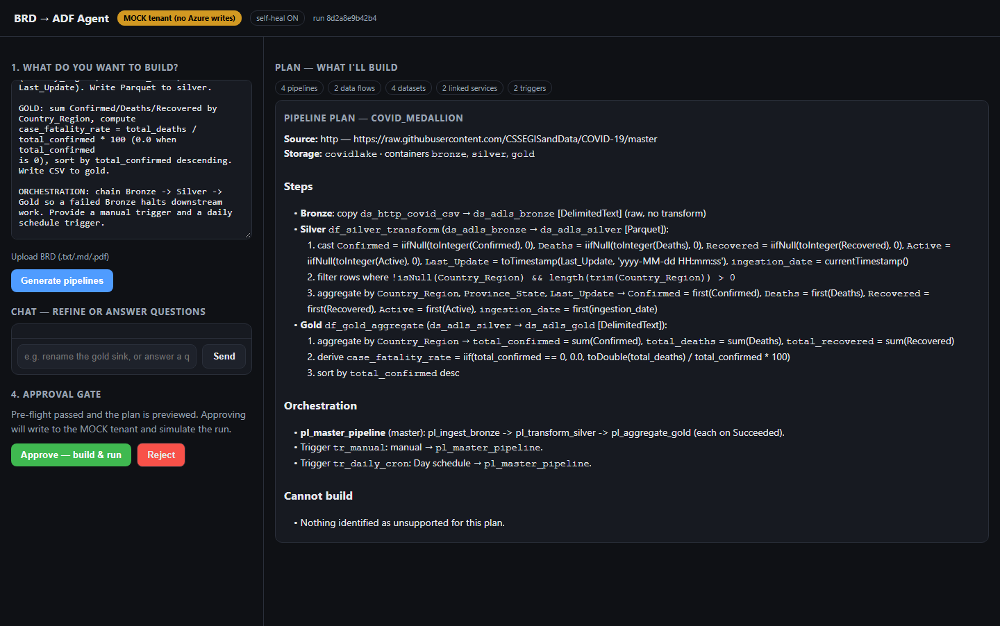
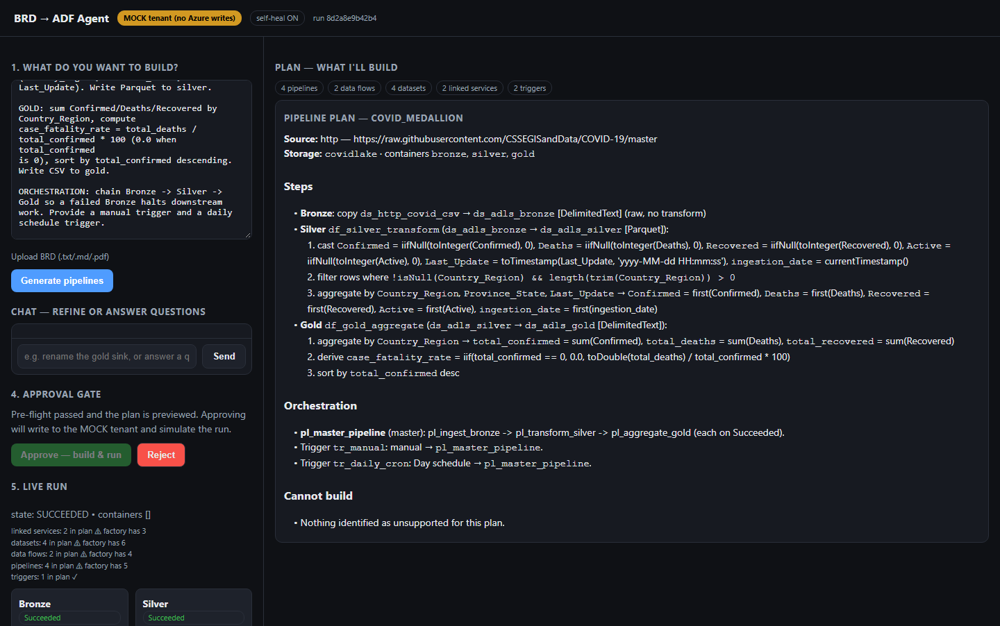

# BRD → ADF Medallion Agent

An LLM agent prototype that turns a data engineer's **Business Requirements Document**
into a deployed **Azure Data Factory** medallion pipeline (Bronze → Silver → Gold).
It shows the generated pipelines for review and, on approval, **builds and runs them for
real** in your Azure subscription, streaming live Bronze→Silver→Gold run status back.
It targets ADF only (no Databricks, Synapse or Fabric), and nothing touches your tenant
before approval.



### Design in 30 seconds

- **The LLM never writes ADF JSON.** It fills a small, validated plan (sources, casts,
  filters, aggregations). Deterministic code compiles that plan into ADF JSON and Data
  Flow script, so the output is always well-formed.
- **Pre-flight gate.** Offline checks (schema, naming, cross-references, script lint,
  column and type checks) must pass before the Approve button unlocks.
- **Human in the loop.** You review every linked service, dataset, data flow and
  pipeline before anything is deployed.
- **Self-healing runs.** A failed deploy or run sends the error back to the model once
  for a targeted fix, then retries. Every attempt is kept in an audit trail.
- **Offline-first.** `MOCK=true` simulates the whole deploy and run locally. The repo
  has 180 unit tests plus a smoke test, all running without Azure or an LLM.



### Limitations & next steps

This is a working prototype, not a hosted product:

- Run state is held in memory. **Next:** persist runs in SQLite or Postgres.
- Auth is a single shared `API_TOKEN`. **Next:** per-user auth and roles.
- Sources are HTTP, Blob/ADLS, REST and SQL, mostly file-based CSV. **Next:** more
  connectors and incremental loads.
- Extraction accuracy across many BRDs isn't reported yet. `tests/eval_spec_gen.py`
  measures it against the golden and held-out BRD sets in `tests/`, but it needs an LLM key.

```
BRD in  →  agent GENERATES pipelines  →  SHOW user (JSON + Data Flow scripts + visual
governance plan)  →  user APPROVES  →  agent CONNECTS TO AZURE, BUILDS + RUNS
for real  →  live run status streamed back.
```

It is **BRD-driven and not hardcoded to one dataset**. A COVID-19 (Johns Hopkins)
BRD ships as the working example, but the agent builds any medallion pipeline its BRD
describes. Sources supported: HTTP/HTTPS file (anonymous), Azure Blob/ADLS, and a
generic REST/CSV endpoint.

## How the layers map (this is the contract)

| Layer  | ADF object | Transformation | Review shows |
| ------ | ---------- | -------------- | ------------ |
| **Bronze** | **Copy Activity only** | none — byte-for-byte raw landing, idempotent overwrite | Copy Activity JSON labelled *"raw landing, no transformation"* — **no script section (its absence is correct)** |
| **Silver** | **Mapping Data Flow** | cast, null handling, filter, dedup, audit columns → Parquet | Data Flow JSON **+ script** |
| **Gold**   | **Mapping Data Flow** | aggregations, derived KPIs (safe division via `iif`), sort | Data Flow JSON **+ script** |

`pl_master_pipeline` chains Bronze → Silver → Gold with `dependsOn: [Succeeded]`, so a
failed Bronze halts downstream work. Naming prefixes `ls_/ds_/df_/pl_` are enforced.

## Design choice that de-risks the hard part

Claude is **never** asked to free-form-write ADF JSON. The LLM reasons in exactly two
places:

1. **Parse** the BRD into a **typed, validated `PipelineSpec`** (Pydantic AI — schema
   enforced, no `json.loads`, no fence-stripping).
2. *(Optional, off by default)* **Self-heal** a failed artifact.

The deterministic `builder.py` turns the typed spec into deployable ADF JSON and the
Data Flow script DSL. So Data Flow JSON generation is reliable **by construction** —
Claude fills structured transform fields; code emits the JSON. (`tests/smoke_test.py`
is the spike that proves this offline.)

**v1 is fail-loud.** On a failed run the error is surfaced in the UI; the Claude
self-heal retry loop is enabled by default and can be disabled with `SELF_HEAL=false`.
failure modes.

## Three-phase validation plan

```
Local dry-run          Azure smoke test        Azure data test
──────────────         ────────────────        ───────────────
JSON valid?      →     Did it deploy?    →     Did data land?
Spec correct?          Did it run?             Are rows correct?
Naming ok?             No SDK errors?          Is it idempotent?
seconds, no deps       ~2 min, Azure access    ~5 min, Azure + data
MOCK=true / smoke_test  small BRD on real ADF   full COVID BRD end-to-end
```

## Project layout

```
models/spec.py      PipelineSpec + sub-models (Http/Blob/Rest sources, Dataset,
                    Transform, DataFlow, Trigger, PipelineDef) + validate_naming()
                    + cross_reference_errors()
config.py           Foundry/Claude client + Azure config + RETRY_CAP + MOCK flag (lazy)
agent/parser.py     Pydantic AI agent: BRD text -> validated PipelineSpec
agent/builder.py    PipelineSpec -> ADF JSON + Data Flow script DSL (pure, offline)
agent/review.py     render() / render_text() - basic execution flow and governance plan
agent/preflight.py  validate() — offline safety guard; blocks approval on failure
agent/deployer.py   provision_containers() + deploy_artifacts() (Azure or MOCK), idempotent
agent/validator.py  execute() — live run + per-layer status; fail-loud; self-heal default-on
ui.py               single-page UI (inline HTML/CSS/JS, no external deps)
app.py              FastAPI: /plan /preview /approve /status /
samples.py          shipped COVID BRD + sample spec
tests/smoke_test.py offline spike / local dry-run
```

## Azure prerequisites (for the real build + run)

1. An **Azure subscription** and a **resource group**.
2. An **Azure Data Factory** instance in that resource group.
3. An **ADLS Gen2 storage account** with **hierarchical namespace enabled**.
4. An **identity** the app runs as (Managed Identity when hosted in Azure, or a
   service principal locally) with:
   - **Data Factory Contributor** on the resource group (to create_or_update ADF objects), and
   - **Storage Blob Data Contributor** on the storage account (to create containers / write data).
   The **ADF's own Managed Identity** also needs **Storage Blob Data Contributor** on the
   account so the pipelines can read/write data at run time.
5. A **Claude on Azure AI Foundry** deployment (Anthropic-compatible endpoint).

No storage account keys, SAS tokens, or connection strings anywhere — Managed Identity
/ service principal only.

## Configuration (environment variables)

Foundry / Claude (needed for `/plan`):

```bash
export FOUNDRY_BASE_URL="https://<resource>.services.ai.azure.com/anthropic"
export FOUNDRY_API_KEY="<key>"          # never hardcoded; env or Key Vault only
export CLAUDE_MODEL="claude-opus-4-8"    # default if unset
```

Azure (needed for `/approve`, unless `MOCK=true`):

```bash
export AZURE_SUBSCRIPTION_ID="..."
export AZURE_RESOURCE_GROUP="..."
export ADF_FACTORY_NAME="..."
export ADLS_ACCOUNT_NAME="covidlake"
# ADLS_ACCOUNT_URL defaults to https://<account>.dfs.core.windows.net
# AZURE_LOCATION defaults to eastus
```

Auth — either `az login` (local dev) **or** a service principal:

```bash
export AZURE_CLIENT_ID="..."
export AZURE_TENANT_ID="..."
export AZURE_CLIENT_SECRET="..."
```

Flags:

```bash
export MOCK=false        # true = local dry-run, writes to mock_tenant/, simulates the run
export SELF_HEAL=true    # default; set false to disable the self-heal retry loop
export PRUNE_STALE=false # true = delete agent-created objects not in this run.
                         # OFF by default: the agent NEVER deletes from your tenant.
                         # When off, stale objects are reported, never removed.
```

Plan-phase performance:

```bash
export PLAN_MODE=auto    # auto (default) = one LLM call to generate, tool agent for
                         #   repairs/refines — fastest path that stays correctable
                         # tools   = every edit via validated tool calls (most robust,
                         #   most model turns)
                         # oneshot = whole plan re-emitted each round (legacy)
export PLAN_CACHE=true   # identical BRD + same mode + same model -> reuse the cached
                         # plan, zero LLM calls (artifacts/.plan_cache/). Set false
                         # when evaluating a model/prompt change.
export GROUND_PLAN=true  # /plan READS source file headers (first 64 KB) to ground
                         # column schemas. Read-only — nothing is created in your
                         # tenant before approval. Set false for a fully offline plan
                         # phase; grounding then runs at /approve, before the deploy.
```

Every `/plan` and `/chat` response carries a `timings` block — per-phase wall-clock
(`extract`, `repair_completeness`, `triage_unsupported`, `compile`, `grounding`,
`repair_preflight`) plus `llm_calls` — so a slow or chatty run is measurable.

## Setup

Prerequisites: Python 3.11+. For real deployments, an Azure subscription with a Data
Factory and ADLS Gen2 account, plus a Claude deployment on Azure AI Foundry. None of
that is needed for the local dry run (`MOCK=true`).

```powershell
git clone https://github.com/karnasanjana/brd-to-adf-agent.git
cd brd-to-adf-agent
py -3.11 -m venv .venv
.\.venv\Scripts\Activate.ps1          # bash/zsh: source .venv/bin/activate
pip install -r requirements.txt
Copy-Item .env.example .env           # bash/zsh: cp .env.example .env
uvicorn app:app --reload --port 8000
```

Open `http://127.0.0.1:8000`. Run the tests with:

```bash
python tests/smoke_test.py
python -m pytest
```

## Phase 1 — Local dry-run (no Azure, no Foundry)

```bash
python tests/smoke_test.py
```

Runs pre-flight on the shipped COVID BRD and prints the Bronze Copy Activity JSON
(no script), the Silver/Gold Data Flow scripts + deployable JSON, and the master
`dependsOn` chain. To exercise the full deploy+run UI offline, start the app with
`MOCK=true` — `/approve` writes to `mock_tenant/` and simulates the Bronze→Silver→Gold
run. The UI shows a **MOCK** banner.

## Phase 2 & 3 — Real end-to-end build + run (a data engineer's walkthrough)

1. Complete the Azure prerequisites and export the env vars above (`MOCK=false`).
2. `uvicorn app:app --reload` and open `http://127.0.0.1:8000`.
3. **Paste or upload your BRD** -> **Generate pipelines**.
4. Review:
   - **Pre-flight** must be green (spec valid, naming, cross-refs resolve, JSON well-formed,
     Bronze Copy present, Silver/Gold scripts present). If it fails, fix the BRD and regenerate
     — approval stays disabled.
   - **Governance plan**: expand the plain-text plan for the audit/approval record.
   - **All objects**: every linked service / dataset / data flow / pipeline / trigger JSON.
5. **Approve — build & run.** The app connects to Azure, creates the bronze/silver/gold
   containers, `create_or_update`s every object, then triggers `pl_master_pipeline`.
6. Watch **live status**: Bronze → Silver → Gold with ADF run IDs and any error message.
7. **Verify outputs:**
   - **ADF Monitor** (portal → your Data Factory → Monitor → Pipeline runs): see the
     `pl_master_pipeline` run and the child Bronze/Silver/Gold runs.
   - **ADLS containers** (portal → storage account → Containers, or Storage Explorer):
     - `bronze/` — the raw landed file (byte-for-byte copy),
     - `silver/` — cleaned/deduped **Parquet**,
     - `gold/` — aggregated **CSV** with the derived KPI.
8. **Idempotency:** re-run `/approve` (or POST again) — no duplicate objects, Bronze
   overwrites, the run repeats cleanly.

## API

| Method & path | Purpose |
| --- | --- |
| `POST /plan` (form: `brd` text or `file` upload) | parse + build + pre-flight; returns run_id, summary, preflight, clarifications, review, governance plan. **No Azure writes.** |
| `GET /preview/{run_id}` | review JSON (all three layers) |
| `GET /preview/{run_id}/text` | plain-text governance plan |
| `POST /approve` (`{run_id}`) | **gate**: requires prior preview AND passing pre-flight, then deploys + runs (Azure or MOCK) |
| `GET /status/{run_id}` | live deploy + Bronze→Silver→Gold run state + run IDs + errors |
| `GET /` | the UI |

## Notes / what's intentionally scoped

- **Ambiguity → clarifications.** If the BRD is unclear, the parser returns a
  `clarifications` list and builds nothing — it never invents components.
- **Run store is in-memory** (`app._RUNS`); swap for a DB to survive restarts.
- **Self-heal is enabled by default**; set `SELF_HEAL=false` to fail loud without retries.
- **MOCK is for development only** and clearly labelled in the UI; real Azure is the
  default, primary path.
- **Manual trigger** is created as an artifact but exercised via `create_run` on demand
  (manual runs aren't ARM trigger resources).
